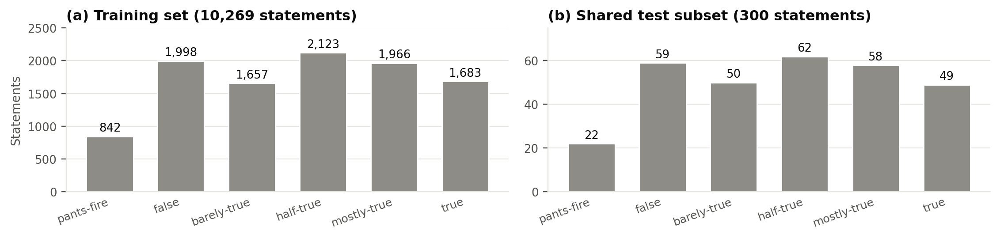
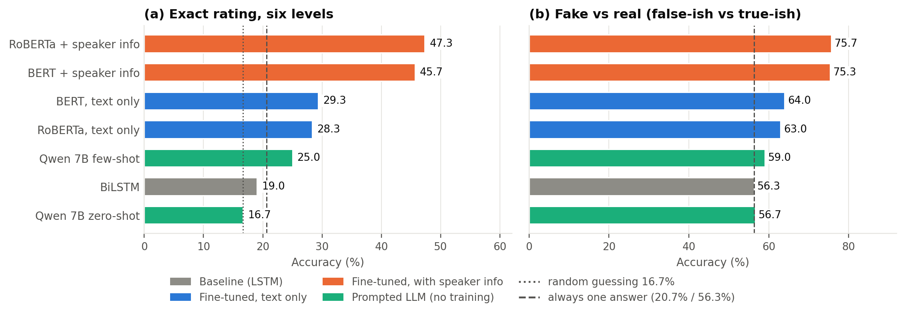
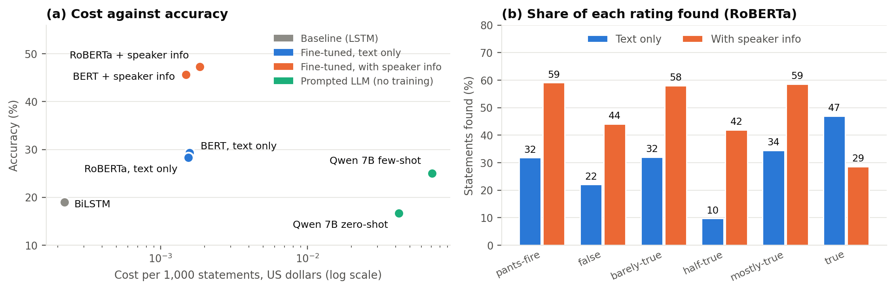
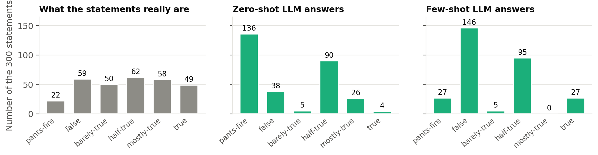

# LIAR Truth Detector:<br>Fine-tuned Transformers vs Zero-shot LLMs

### Evidence from political statements in the LIAR dataset

**PRACHI DHAKAD, SANDHYA [SURNAME], SUZZY [SURNAME] and ARUN [SURNAME]**

[Department], [University], [City], [Country]

*(Draft, 22 November 2026)*

## Abstract

False claims by public figures spread quickly, and fact-checkers cannot rate every claim by hand. We compare three ways to rate the truthfulness of short political statements on the six-level LIAR scale: a BiLSTM trained from scratch, BERT and RoBERTa fine-tuned with and without speaker information, and the Qwen2.5-7B-Instruct LLM prompted zero-shot and few-shot. All seven models were scored on the same 300 test statements with the same cost model. From the statement alone, BERT and RoBERTa reached 28 to 29% accuracy on six levels, and 63 to 64% when the ratings are grouped into false-ish and true-ish. The prompted 7B model was not clearly different in accuracy (25.0% few-shot) but clearly worse in macro-F1 (0.183 against 0.289), and it cost about 45 times more per prediction. Adding speaker information raised accuracy by about 16 points, to 47.3% for the best model (75.7% fake vs real), but part of that gain comes from speaker-history counts that include the rated statement itself. Inspection of the outputs shows that the LLM leans on one or two ratings, and that most errors of the fine-tuned models are one level from the truth. We discuss the limits of our setup: one seed, 300 test statements, one LLM and prompt, and US political text only.

## 1 Introduction

Many claims in politics are partly true, out of context, or simply false. Fact-checkers such as PolitiFact read the evidence and rate each claim, but this is slow work. A tool that gives a quick first guess would help a reviewer decide which claims to read first. This is hard, because a model sees only the words of a claim, and sometimes who said it, not the evidence behind it.

Pre-trained transformers such as BERT are cheap to fine-tune, while large language models (LLMs) can be prompted without any training but are much bigger and slower. It is not obvious which is the better choice for rating claims once cost is counted, and the effect of speaker information is easy to over-read because of a quirk of the dataset. This project therefore asks three questions.

**RQ1.** Is a small fine-tuned model better than a prompted 7B LLM, once accuracy and cost are both counted?

**RQ2.** How much does speaker information add, and how should that gain be read?

**RQ3.** What kinds of mistakes do the models make?

To answer them we compared seven models on the same 300 test statements, tested differences with McNemar's exact test, and priced every model with one shared cost model. Besides accuracy, we look at the outputs themselves, which shows behaviours that affect how the numbers should be read. Code, data and result files are available at https://github.com/arunchowdary-1/Fake-News-Detection-Fine-tuned-Transformers-vs-Zero-shot-LLMs.

## 2 Related work

**The LIAR dataset.** Wang (2017) released LIAR as a larger and more detailed benchmark for fake news detection than earlier sets. Each statement comes with the speaker, party, subject and a count of the speaker's past ratings. The paper also tests adding this metadata to a text model, which is the question we ask for BERT and RoBERTa.

**Fine-tuned models.** LSTMs (Hochreiter and Schmidhuber 1997) read a sentence one word at a time and were the standard text model before transformers, so they make a natural baseline. BERT (Devlin et al. 2019) is first trained on a very large amount of text and then fine-tuned on a small labelled set. RoBERTa (Liu et al. 2019) keeps the design but is trained for longer on more data.

**Prompted LLMs.** Large LLMs can do a new task from instructions alone (zero-shot) or after seeing a few worked examples in the prompt (few-shot) (Brown et al. 2020). This avoids training, but the model is large. We use Qwen2.5-7B-Instruct (Qwen Team 2024) in 4-bit form (Dettmers et al. 2023) so that it fits on one 16 GB GPU. We run a like-for-like comparison of these three families and add the cost side, which is often left out.

## 3 Experimental setup

### 3.1 Data

LIAR contains 12,836 short statements, mostly from US politicians, each rated by PolitiFact from *pants-fire* (ridiculously false) to *true* on six levels. A statement is about 18 words on average and comes with its speaker (2,916 different speakers in the training set), party, subject, job title, state, context and five counts of the speaker's past ratings. We use the standard Hugging Face split (Table 1). The library stores the labels as integers in an order that differs from ours, so we map them by name.

**Table 1.** The LIAR splits used in this project.

| Split | Statements | Used for |
|---|---|---|
| Train | 10,269 | training the models, choosing the LLM examples |
| Validation | 1,284 | picking the best training epoch |
| Test | 1,283 | final scores (full set) |
| Test subset | 300 | headline scores, the same rows for every model |

The 300-statement subset was drawn once (seed 42) so that its mix of ratings matches the full test set (Fig. 1). We use it for all headline numbers because the 7B model is too slow to run on every statement. The five credit-history counts include the rating of the current statement itself, so a model can read part of the answer from them. We return to this in Section 5.



**Fig. 1.** Number of statements per rating in (a) the training set and (b) the shared test subset.

### 3.2 Models

Table 2 lists the seven models. BERT and RoBERTa were each trained twice: on the statement alone, and with the speaker, party, subject and credit history written in front of it, as in the example below. Fine-tuning used AdamW (Loshchilov and Hutter 2019) with weight decay 0.01, gradient clipping at 1.0, fp16 arithmetic and inverse-frequency class weights in the loss. The best epoch was chosen by macro-F1 on the validation set (the last epoch in every BERT and RoBERTa run). The LSTM used word vectors of size 100 learned from scratch, a vocabulary built from the training set only, and one bidirectional layer of 128 units (932,998 parameters). We used the Transformers library (Wolf et al. 2020).

```
speaker: dwayne-bohac | party: republican | subject: abortion | history: 0,1,0,0,0 [SEP] Says the Annies List political group supports third-trimester abortions on demand.
```

**Table 2.** Models, inputs and settings. All runs use seed 42.

| Model | Parameters | Input | Training or prompting |
|---|---|---|---|
| BiLSTM | 0.9M | statement (up to 64 words) | trained from scratch; Adam, learning rate 0.001, batch 64, up to 15 epochs (best: 6), dropout 0.5; CPU |
| BERT, RoBERTa (text only) | 109M, 125M | statement (up to 128 tokens) | fine-tuned; learning rate 2e-5, batch 16, 3 epochs, 10% warm-up; Colab T4 |
| BERT, RoBERTa + speaker info | 109M, 125M | speaker, party, subject, history and statement (up to 256 tokens) | same as above |
| Qwen2.5-7B zero-shot | 7.6B | statement only | no training; instructions only; 4-bit FP4; Kaggle T4 |
| Qwen2.5-7B few-shot | 7.6B | statement only | six worked examples, one per rating, from the training set (seed 42) |

### 3.3 Prompting and answer extraction

A system message tells the LLM that it is a fact-checking expert, lists the six labels and says "Respond with ONLY the label, nothing else." The statement follows. The few-shot prompt adds six solved examples (60 to 200 characters each, shuffled so that the last one does not favour a rating); because they come from the training set, none can appear in the test subset. Decoding is greedy with at most 12 new tokens, so runs are repeatable. Each prompt was written once and run once. An answer counts only if it contains exactly one valid label: spelling variants such as "pants on fire" are accepted, while answers with a negation ("not true") or two labels are rejected. A rejected answer is marked *invalid* and counted as wrong, so parsing never raises the score.

### 3.4 Evaluation

We report accuracy and macro-F1, which averages the F1 score of the six ratings so that a model cannot do well by favouring a few of them. As a simpler view we also group pants-fire, false and barely-true as *false-ish* and the other three as *true-ish* ("fake vs real"); this grouping is our own choice and was not used in training. Random guessing scores 16.7% on six levels, always answering the most common rating (half-true) scores 20.7%, and always choosing the more common side scores 56.3% on fake vs real. With 300 statements, each accuracy is uncertain by about ±5 points. Differences between two models on the same statements are tested with McNemar's exact test (McNemar 1947). Every model is priced as if it ran on a Tesla T4 GPU at $0.35 per hour plus 10% overhead, one statement at a time.

## 4 Results

### 4.1 Overall accuracy

Table 3 and Fig. 2 show all seven models. From the statement alone, BERT and RoBERTa reach 28 to 29% on six levels and 63 to 64% on fake vs real. The BiLSTM is close to guessing (19.0%), and zero-shot Qwen is at chance level (16.7%). With speaker information, accuracy rises to 45.7% (BERT) and 47.3% (RoBERTa), and fake-vs-real accuracy to about 75%. The full-test results agree closely with the subset, which gives us more confidence in them; the LLM was not run on the full set.

**Table 3.** Results on the shared 300-statement subset, and on the full test set (1,283 statements) where available.

| Model | Accuracy | Macro-F1 | Fake vs real | Full test (acc. / macro-F1) | Invalid |
|---|---|---|---|---|---|
| RoBERTa + speaker info | **0.473** | **0.483** | **75.7%** | 0.461 / 0.467 | 0 / 300 |
| BERT + speaker info | 0.457 | 0.470 | 75.3% | 0.449 / 0.457 | 0 / 300 |
| BERT, text only | 0.293 | 0.289 | 64.0% | 0.273 / 0.277 | 0 / 300 |
| RoBERTa, text only | 0.283 | 0.282 | 63.0% | 0.288 / 0.291 | 0 / 300 |
| Qwen 7B few-shot | 0.250 | 0.183 | 59.0% | n/a | 0 / 300 |
| BiLSTM | 0.190 | 0.173 | 56.3% | 0.212 / 0.201 | 0 / 300 |
| Qwen 7B zero-shot | 0.167 | 0.126 | 56.7% | n/a | 1 / 300 |



**Fig. 2.** Accuracy on the shared test subset: (a) exact rating on six levels, (b) fake vs real. Colours show the kind of model.

### 4.2 Fine-tuned versus prompted (RQ1)

Table 4 gives paired comparisons on the same 300 statements. Few-shot beats zero-shot (+8.3 points, p = 0.004), so the six examples helped. Zero-shot is clearly worse than text-only BERT (p = 0.0004). Text-only BERT is 4.3 points ahead of few-shot in accuracy, but this is within the noise of 300 statements (p = 0.27). The difference shows up in macro-F1, 0.289 against 0.183, because the LLM favours a few ratings (Section 4.5). BERT and RoBERTa are tied: they differ by about one point, well inside the noise.

**Table 4.** McNemar exact tests. "Only A right" counts statements that A got right and B got wrong.

| Comparison (A − B) | Difference (points) | Only A right | Only B right | p-value |
|---|---|---|---|---|
| Qwen few-shot − Qwen zero-shot | +8.3 | 48 | 23 | 0.004 |
| BERT text only − Qwen few-shot | +4.3 | 66 | 53 | 0.27 |
| BERT text only − Qwen zero-shot | +12.7 | 75 | 37 | 0.0004 |
| BERT + speaker info − BERT text only | +16.3 | 83 | 34 | < 0.0001 |
| RoBERTa text only − BERT text only | −1.0 | 30 | 33 | 0.80 |
| RoBERTa + speaker info − BERT + speaker info | +1.7 | 30 | 25 | 0.59 |

### 4.3 Effect of speaker information (RQ2)

Adding speaker, party, subject and history raised BERT's accuracy by 16.3 points (p < 0.0001) for about 30 seconds of extra training. Fig. 3(b) shows where: for RoBERTa it raises the share found for five of the six ratings, for example half-true from 10% to 42% and pants-fire from 32% to 59%. The exception is *true*, which falls from 47% to 29%. As noted in Section 3.1, part of this gain comes from the history counts.

### 4.4 Cost and speed

Table 5 and Fig. 3(a) compare size, time and cost. Text-only BERT classifies 1,000 statements in 14.7 seconds for $0.0016. The few-shot LLM needs 661 seconds and $0.0707, so BERT is about 70 times smaller, 45 times faster and 45 times cheaper, and it scores 0.106 higher in macro-F1. BERT's one-off training cost of about $0.02 is paid back after roughly 300 predictions. These ratios are an upper bound, because the LLM ran one statement at a time and a batching server would narrow the gap.

**Table 5.** Size, time and cost at the shared T4 price, batch size 1. The BiLSTM was timed on a CPU.

| Model | Parameters | Train (min) | Seconds per 1,000 | $ per 1,000 | GPU memory (MB) |
|---|---|---|---|---|---|
| BiLSTM | 1M | 3.9 | 2.1 | 0.0002 | n/a |
| BERT, text only | 109M | 3.2 | 14.7 | 0.0016 | 2,144 |
| BERT + speaker info | 109M | 3.8 | 13.9 | 0.0015 | 2,301 |
| RoBERTa, text only | 125M | 3.4 | 14.4 | 0.0015 | 2,429 |
| RoBERTa + speaker info | 125M | 3.9 | 17.3 | 0.0018 | 2,502 |
| Qwen 7B zero-shot | 7,616M | none | 393.5 | 0.0421 | 5,743 |
| Qwen 7B few-shot | 7,616M | none | 661.3 | 0.0707 | 5,789 |



**Fig. 3.** (a) Cost against accuracy; the best models are in the top left. (b) Share of each real rating that RoBERTa found, with and without speaker information.

### 4.5 Error behaviour (RQ3)

**Near misses.** Between 42% and 54% of the errors of RoBERTa fall on a neighbouring level, such as *mostly-true* called *true* (Fig. 4). Half-true is the hardest rating for every model; without speaker information RoBERTa finds only 10% of them. Table 6 shows two half-true statements that it called true. Both are true in part and misleading in part, so even a careful reader would need the evidence.


**Fig. 4.** Confusion matrices for RoBERTa on the 300 statements. Rows are the real rating, columns are the model's answer.

**Table 6.** Two statements rated half-true that text-only RoBERTa called true.

| Speaker | Statement |
|---|---|
| facebook-posts | "1 percent of Americans are millionaires. 47 percent of House Reps. are millionaires. 56 percent of Senators are millionaires." |
| nikki-haley | "Says President Obama and his National Labor Relations Board sued Boeing over its decision to open a plant in South Carolina." |

**Label bias of the LLM.** The LLM does not spread its answers over the six ratings (Fig. 5). Zero-shot, it answered *pants-fire* for 136 of the 300 statements (45%), although only 22 really are pants-fire, and it almost never said *true* or *barely-true*. Few-shot moved the bias: it answered *false* for 146 statements (49%) and never answered *mostly-true*. Only one zero-shot answer (and none few-shot) was invalid, so parsing did not drive these results.



**Fig. 5.** The real ratings of the 300 statements (left) and the ratings chosen by the zero-shot (middle) and few-shot (right) LLM.

## 5 Discussion

**Small fine-tuned models win here.** A few minutes of training on 10,000 labelled statements taught BERT the six-level scale better than instructions and six examples taught the 7B model. Pre-training matters: the BiLSTM, which starts from nothing, is barely above guessing. The six levels are subtle, and an instruction-following model with no task data seems to map "sounds dubious" to *false* or *pants-fire* and has no sense of where the middle ratings begin.

**Speaker information helps, but read it with care.** The credit-history counts include the rating of the statement being predicted, so the best result is best described as the value of knowing who is speaking, not as better understanding of the claim. The fair comparison with the LLM, which sees only the statement, is the text-only models, and on a brand-new statement we should expect results closer to those. The cleaner test, speaker, party and subject without the counts, has not been run.

**A triage aid, not a judge.** On fake vs real the best model is right about three times in four against a baseline of 56%, but the best text-only model gets the exact rating right fewer than three times in ten. We suggest using it only to help a human reviewer prioritise: if the speaker is known, a model with speaker information; if not, text-only BERT. This is a suggestion for the team to confirm, not a final decision.

## 6 Limitations and ethical considerations

- The data is short, English, US political text. We expect worse results on other topics, countries, languages and full articles, but did not test them.
- We used 300 test statements and one seed, so each accuracy is uncertain by about ±5 points and run-to-run variation is not measured. The LLM was scored on the 300-statement subset only.
- The history counts include the answer (Section 5), and the fake-vs-real grouping is our own choice made after training.
- We tried one LLM, one prompt and 4-bit weights. Other models, prompts, retrieved examples or fine-tuning the LLM could narrow the gap. The LLM also never saw the speaker, so it did not get the same information as the speaker-aware models. The last epoch was the best for BERT and RoBERTa, so longer training might add a little.
- Absolute accuracy is modest, as is usual for LIAR, where text-only models typically score 25 to 30% on six levels.
- A demo application, a project README and an automated-test workflow were planned but are not in the repository.
- PolitiFact ratings are human judgements, and a model learns their biases. A model that uses the speaker can learn that some people or parties are "usually false", which may hold in the data and still be unfair to a particular claim, so speaker-aware models should not rate individual people's statements automatically. A wrong rating can damage a reputation or spread a false belief, so a human should make the final call. LIAR is public data, no personal data or secrets were used, and the packages should be checked against your organisation's approved-software list before installation.

## 7 Conclusion

We compared seven models for rating the truthfulness of short political statements. A small fine-tuned model was as accurate as a prompted 7B LLM and clearly better in macro-F1, while being about 70 times smaller and 45 times cheaper to run. Adding the speaker raised accuracy from about 29% to about 46%, giving a best result of 47.3% on six levels and 75.7% on fake vs real, but part of that gain comes from history counts that include the answer. Looking at the outputs showed that the LLM leans on one or two ratings, and that most errors of the fine-tuned models are one level from the truth. Future work could remove the history counts, add a demo application, use more statements and seeds, try other LLMs, prompts and fine-tuning, and train on data beyond US politics. The model is a helper for human reviewers, not a replacement for them.

## References

Brown, T., Mann, B., Ryder, N. et al. (2020) Language models are few-shot learners. In *Advances in Neural Information Processing Systems 33*. arXiv:2005.14165.

Dettmers, T., Pagnoni, A., Holtzman, A. and Zettlemoyer, L. (2023) QLoRA: Efficient finetuning of quantized LLMs. In *Advances in Neural Information Processing Systems 36*. arXiv:2305.14314.

Devlin, J., Chang, M.-W., Lee, K. and Toutanova, K. (2019) BERT: Pre-training of deep bidirectional transformers for language understanding. In *Proceedings of NAACL-HLT 2019*, pp. 4171-4186. arXiv:1810.04805.

Hochreiter, S. and Schmidhuber, J. (1997) Long short-term memory. *Neural Computation* 9(8), 1735-1780.

Liu, Y., Ott, M., Goyal, N. et al. (2019) RoBERTa: A robustly optimized BERT pretraining approach. arXiv:1907.11692.

Loshchilov, I. and Hutter, F. (2019) Decoupled weight decay regularization. In *International Conference on Learning Representations (ICLR 2019)*. arXiv:1711.05101.

McNemar, Q. (1947) Note on the sampling error of the difference between correlated proportions or percentages. *Psychometrika* 12(2), 153-157.

Qwen Team (2024) Qwen2.5 technical report. arXiv:2412.15115.

Wang, W. Y. (2017) "Liar, liar pants on fire": A new benchmark dataset for fake news detection. In *Proceedings of ACL 2017 (Short Papers)*, pp. 422-426. arXiv:1705.00648.

Wolf, T., Debut, L., Sanh, V. et al. (2020) Transformers: State-of-the-art natural language processing. In *Proceedings of EMNLP 2020: System Demonstrations*, pp. 38-45.
