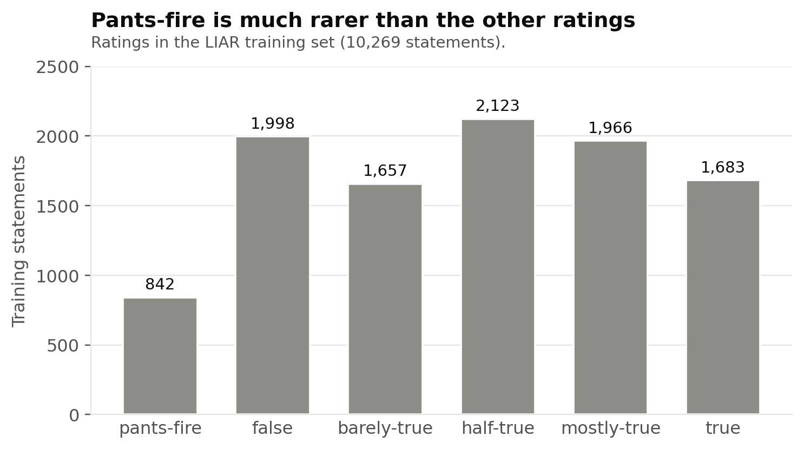
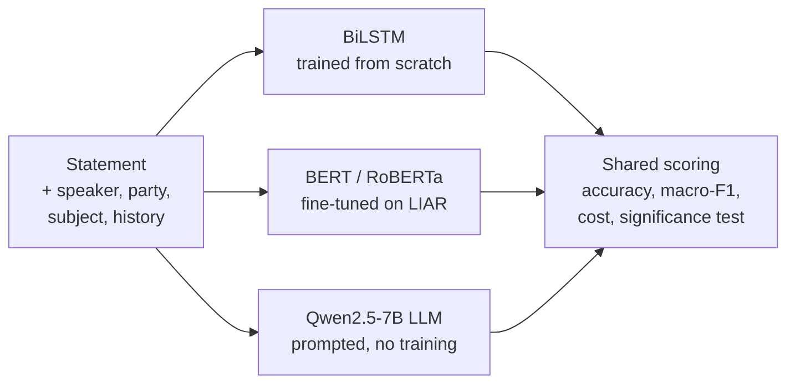
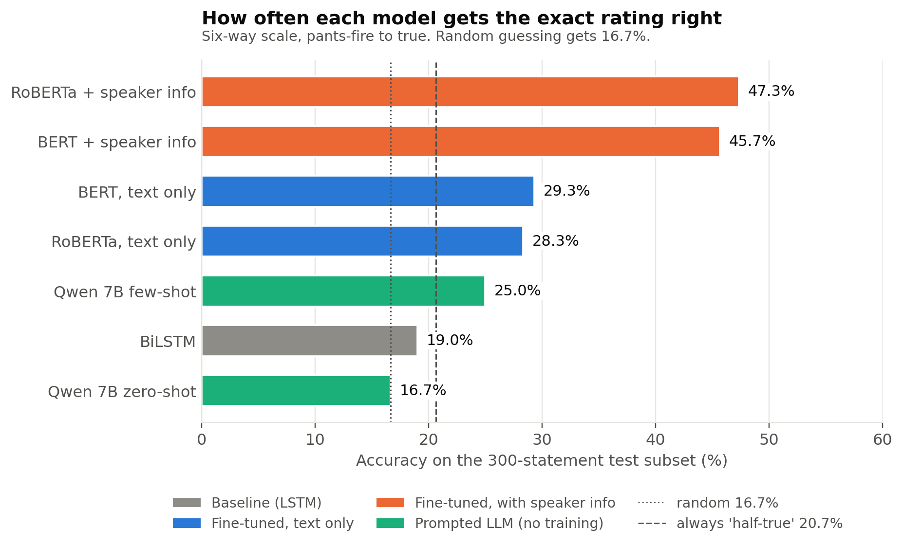
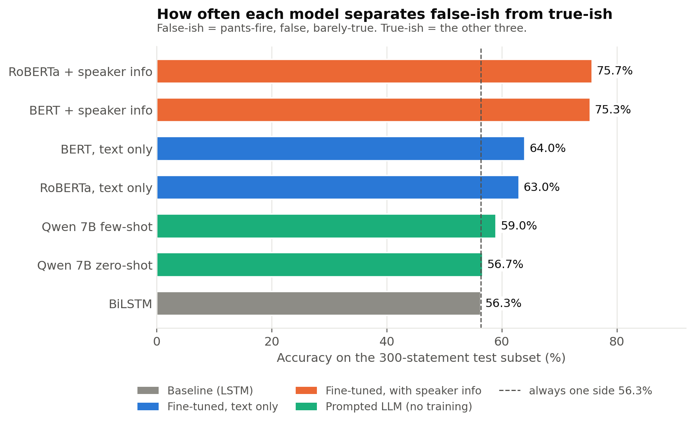
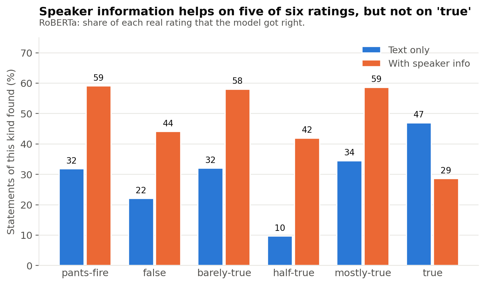
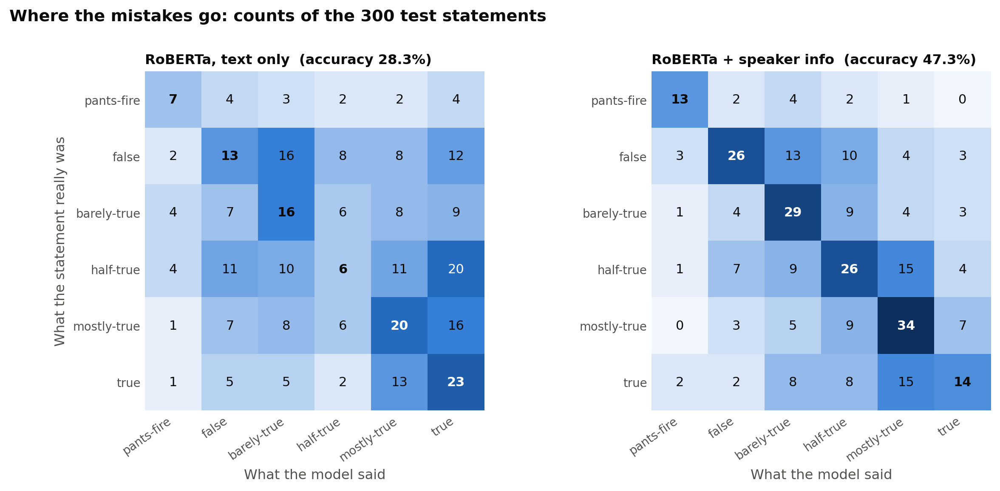
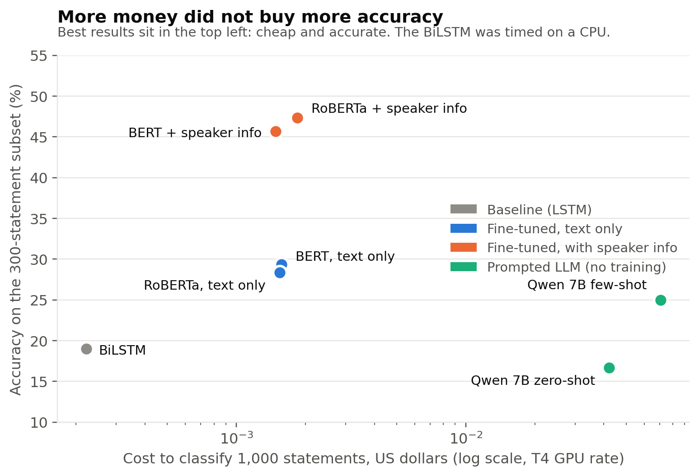

# LIAR Truth Detector

### A fake news detection model for political statements
*Fine-tuned transformers vs zero-shot LLMs*

**Team:** Prachi Dhakad, Sandhya, Suzzy, Arun
**Dataset:** LIAR (Wang, 2017)

> All numbers in this report come from the result files in `results/` and can be reproduced with the steps in
> [Appendix D](#appendix-d-how-to-reproduce-the-results). Figures are drawn from the same files by
> `report/make_figures.py`.

---

## Results at a glance

| | |
|---|---|
| **Best model** | RoBERTa fine-tuned with speaker information |
| **Fake vs real** | **75.7%** correct (always guessing the common side gets 56.3%) |
| **Exact rating (6 levels)** | **47.3%** correct, nearly 3 times random guessing (16.7%) |
| **Statement text alone** | 28 to 29% on six levels, 63 to 64% on fake vs real |
| **Small vs big** | A 110M-parameter BERT matches or beats a 7.6B-parameter LLM. It is about 70 times smaller and about 45 times cheaper to run. |
| **Training time** | 3 to 4 minutes per model on one T4 GPU |
| **Code** | 99 automated tests pass |

---

## Contents

1. [Abstract](#abstract)
2. [Introduction](#1-introduction)
3. [Related work](#2-related-work)
4. [Dataset](#3-dataset)
5. [Methodology](#4-methodology)
6. [Experiments and results](#5-experiments-and-results)
7. [Analysis and discussion](#6-analysis-and-discussion)
8. [Limitations and ethics](#7-limitations-and-ethics)
9. [Conclusion and future work](#8-conclusion-and-future-work)
10. [References](#references)
11. Appendices: [A Settings](#appendix-a-training-settings) · [B Prompt](#appendix-b-the-llm-prompt) · [C Teamwork](#appendix-c-how-the-work-was-organised) · [D Reproduce](#appendix-d-how-to-reproduce-the-results)

---

## Abstract

False claims by public figures spread quickly, and fact-checkers cannot rate every claim by hand. We built a model
that gives a first rating of how true a short political statement is, on the six-step scale used by the LIAR
dataset (from *pants-fire* to *true*). We trained and compared seven models: a small LSTM trained from scratch, BERT
and RoBERTa fine-tuned on LIAR (each with and without information about the speaker), and the Qwen2.5-7B LLM used
with a prompt but no training (zero-shot and few-shot). Every model was scored in the same way, on the same 300
test statements, with the same cost model.

The best model, RoBERTa with speaker information, got the exact rating right for 47.3% of statements and separated
false-ish from true-ish statements correctly 75.7% of the time. From the statement text alone, BERT and RoBERTa
reached 28 to 29% on six levels. The prompted 7B LLM was no better than BERT in accuracy and clearly worse in
macro-F1 (0.183 against 0.289), while being about 70 times larger and about 45 times more expensive to run. Adding
the speaker, party and subject improved accuracy by about 16 points. Part of that gain comes from a property of the
dataset, explained in [section 6.3](#63-an-important-caveat-about-the-best-result). Our results are based on one
training run per setting and 300 test statements, so each accuracy is uncertain by about ±5 points. The model is
built for short US political statements and should not be used on other kinds of news.

---

## 1. Introduction

### 1.1 The problem
Many claims in politics are partly true, badly out of context, or simply false. Professional fact-checkers such as
PolitiFact read the evidence and give each claim a rating, but this is slow work. A tool that could give a quick
first guess would help a reviewer decide which claims to look at first.

This is harder than it sounds. A statement like "1 percent of Americans are millionaires" can be true, half true or
misleading depending on facts the model cannot see. The model has to learn from the wording of a claim, and
sometimes from who said it.

### 1.2 What we did
We used the public **LIAR** benchmark ([Wang, 2017](#references)), which has about 12,800 statements, each rated by
PolitiFact on six levels. We then:

1. built a shared data and scoring pipeline, so every model is tested in exactly the same way;
2. trained a small **BiLSTM** as a cheap baseline;
3. fine-tuned **BERT** and **RoBERTa**, each twice: once on the statement alone and once with the speaker, party,
   subject and credit history added;
4. prompted the open **Qwen2.5-7B-Instruct** LLM with instructions only (zero-shot) and with six examples (few-shot);
5. compared accuracy, macro-F1, time and cost, and checked which differences are real with a statistical test.

### 1.3 The question we wanted to answer
> **Is a small model that we fine-tune (about 110 million parameters) better than a big LLM (7.6 billion
> parameters) that we only prompt, once we count both accuracy and cost?**

### 1.4 Our contributions
- A fair, repeatable comparison of seven models on one dataset, with shared labels, seed, test subset, metrics and
  cost model.
- Evidence that the fine-tuned model matches or beats the prompted LLM at a small fraction of the cost.
- A measurement of how much speaker information helps, and a clear explanation of why that number should be read
  with care.
- An analysis of the mistakes: which ratings get confused, and how the LLM favours a few ratings.
- Several bugs found and fixed along the way ([section 6.5](#65-bugs-we-found-and-fixed)), and a test suite of 99 tests.

---

## 2. Related work

**The LIAR dataset.** Wang released LIAR to give researchers a larger and more detailed benchmark for fake news
detection than earlier sets. Each statement comes with the speaker, party, subject and a count of the speaker's past
ratings. The paper also tests adding this metadata to a text model, which is the same question we ask for BERT and
RoBERTa.

**Recurrent networks.** LSTMs (Hochreiter and Schmidhuber, 1997) read a sentence one word at a time and keep a memory
of what they have seen. They were the standard text model before transformers, so they make a natural baseline.

**Pre-trained transformers.** BERT (Devlin et al., 2019) is a transformer (Vaswani et al., 2017) that is first trained
on a very large amount of text and then fine-tuned for a task with a small amount of labelled data. RoBERTa
(Liu et al., 2019) keeps the same design but is trained for longer on more data. Both are the usual strong choice for
classifying short texts.

**Prompted large language models.** Large LLMs can do a new task from instructions alone (zero-shot) or after seeing a
few worked examples in the prompt (few-shot) (Brown et al., 2020). This avoids training, but the model is large and
slow. We use Qwen2.5-7B-Instruct (Qwen Team, 2024), run in 4-bit form (Dettmers et al., 2023) so that it fits on a
single 16 GB GPU.

**Where our work fits.** We do not propose a new model. We run a careful, like-for-like comparison of these three
families on LIAR and add the cost side, which is often left out.

---

## 3. Dataset

LIAR contains short statements that PolitiFact fact-checked, mostly from US politicians and public figures (speeches,
interviews, debates and social media posts). We use the Hugging Face copy of the dataset with its standard split.

| Split | Statements | Used for |
|---|---|---|
| Train | 10,269 | training the models, choosing the LLM examples |
| Validation | 1,284 | picking the best training epoch |
| Test | 1,283 | final scores (full set) |
| Test subset | 300 | headline scores, the same rows for every model |

### 3.1 The six ratings
Every statement has one of six ratings, from least to most truthful: *pants-fire* (ridiculously false), *false*,
*barely-true*, *half-true*, *mostly-true* and *true*. The ratings are fairly balanced except for *pants-fire*, which is
much rarer.



### 3.2 What each statement comes with

| Field | What it holds |
|---|---|
| statement | The claim itself, about 18 words on average (longest: 66 words) |
| label | The PolitiFact rating, one of the six levels |
| speaker, job title, state | Who said it, their job and the US state |
| party affiliation | For example republican (4,510 training rows), democrat (3,345), none (1,746) |
| subject | The topic, such as economy (896), health care (745) or education (546) |
| credit history | Five counts of the speaker's past statements rated barely-true, false, half-true, mostly-true and pants-on-fire |
| context | Where the claim was made (a speech, an interview, a post) |

The training set has 2,916 different speakers. Many speakers appear many times, which is one reason that knowing the
speaker helps a model.

### 3.3 A property of the data that matters later
In the LIAR release, the five credit-history counts include the rating of the current statement itself. A model can
therefore see part of the answer in the speaker's history. We come back to this in
[section 6.3](#63-an-important-caveat-about-the-best-result).

### 3.4 Scope
All statements are short, English and political, and nearly all are from the United States. The models in this report
know nothing else, and we make no claim about other kinds of news.

---

## 4. Methodology

### 4.1 Overview
A statement goes in, one of three kinds of model reads it, and a shared scoring step produces the numbers we compare.



### 4.2 Keeping the comparison fair
A comparison is only useful if every model is tested in the same way. We fixed the following for all models.

- **Labels:** the same six labels in the same order.
- **Random seed:** 42 everywhere.
- **Test subset:** the same 300 test statements for every model, chosen so that the mix of ratings matches the full
  test set (22 pants-fire, 59 false, 50 barely-true, 62 half-true, 58 mostly-true, 49 true). We use this subset for
  the headline numbers because the 7B LLM is too slow to run on all 1,283 statements. Where we have them, full-test
  numbers are reported too.
- **Scoring code:** one shared function computes accuracy, macro-F1 and the confusion matrix.
- **Cost:** every model is priced as if it ran on a Tesla T4 GPU at $0.35 per hour plus 10% overhead, one statement
  at a time (batch size 1).

**Reference points.** Random guessing scores 16.7% on six levels. Always answering the most common rating in the subset
(half-true) scores 20.7%. For the fake-vs-real view, always guessing the more common side scores 56.3%. With only 300
statements, each accuracy is uncertain by about ±5 points.

### 4.3 Model 1: BiLSTM baseline
The LSTM is the simplest model and starts with no knowledge of language. It reads the statement in both directions,
combines the final state with the strongest signal from any word, and outputs six scores.

- Word vectors of size 100, learned from scratch. The vocabulary has at most 20,000 words seen at least twice in the
  training set only, so nothing leaks from the test set.
- One bidirectional LSTM layer with 128 units per direction and dropout 0.5. Statements are cut at 64 words.
- Adam optimiser, learning rate 0.001, batch size 64, up to 15 epochs with early stopping after 3 epochs without
  improvement. The best epoch was the 6th.
- Class weights in the loss, so rare ratings count more.
- 932,998 trainable parameters. It trains on a CPU in about 4 minutes.

### 4.4 Models 2 to 5: BERT and RoBERTa
We fine-tuned `bert-base-uncased` (109.5M parameters) and `roberta-base` (124.7M parameters) with a new six-way output
layer. Each was trained twice:

- **Text only:** the input is just the statement (up to 128 tokens).
- **With speaker information:** the speaker, party, subject and credit history are written in front of the statement
  (up to 256 tokens). A real training row looks like this:

```
speaker: dwayne-bohac | party: republican | subject: abortion | history: 0,1,0,0,0 [SEP] Says the Annies List political group supports third-trimester abortions on demand.
```

The training setup was identical for all four runs: AdamW optimiser (Loshchilov and Hutter, 2019) with learning rate
2e-5 and weight decay 0.01, batch size 16, 3 epochs, a 10% warm-up followed by a linear decrease of the learning rate,
gradient clipping at 1.0, mixed-precision (fp16) arithmetic, and inverse-frequency class weights in the loss. The best
epoch was chosen by macro-F1 on the validation set, and it was the last epoch in every run. We used the Hugging Face
Transformers library (Wolf et al., 2020) on a Colab Tesla T4.

### 4.5 Models 6 and 7: the prompted LLM
We used `Qwen2.5-7B-Instruct` without any training, in 4-bit form (FP4 from the bitsandbytes library) on a Kaggle
Tesla T4.

- **Zero-shot prompt:** a system message tells the model it is a fact-checking expert, lists the six labels and says
  "Respond with ONLY the label, nothing else." The statement follows.
- **Few-shot prompt:** the same prompt, plus six worked examples (one per rating) taken from the *training* set with
  seed 42, each 60 to 200 characters long and shuffled so that the last example does not favour one rating. Because
  they come from the training set, none can appear in the test subset.
- **Decoding:** greedy (always the most likely next word), at most 12 new tokens, so runs are repeatable.
- **Strict parsing:** an answer counts only if it contains exactly one valid label. "Pants on fire" is accepted as
  pants-fire, but answers with a negation ("not true") or with two labels are rejected. A rejected answer is marked
  *invalid* and counted as wrong, so parsing never raises the score.
- **No prompt tuning:** each prompt was written once and run once. A 20-statement test checked only that the output
  could be parsed.
- **Input:** the statement only. The LLM was not shown the speaker or party.

### 4.6 Metrics and statistical test
**Accuracy** is the share of statements given exactly the right rating. **Macro-F1** averages the F1 score of each of
the six ratings, so a model cannot score well by favouring a few common ratings. For the **fake-vs-real view** we group
pants-fire, false and barely-true as *false-ish* and the other three as *true-ish*. This grouping is our own choice and
was not part of training.

To tell real differences from luck we use **McNemar's exact test** (McNemar, 1947). It looks only at the statements
where two models disagree, and asks whether one wins more often than chance would allow.

---

## 5. Experiments and results

### 5.1 Main results
All scores below are on the shared 300-statement subset. The fake-vs-real column is our own grouping of the saved
predictions. The BiLSTM was timed on a CPU.

| Model | Accuracy | Macro-F1 | Fake vs real | Invalid answers |
|---|---|---|---|---|
| **RoBERTa + speaker info** | **0.473** | **0.483** | **75.7%** | 0 / 300 |
| BERT + speaker info | 0.457 | 0.470 | 75.3% | 0 / 300 |
| BERT, text only | 0.293 | 0.289 | 64.0% | 0 / 300 |
| RoBERTa, text only | 0.283 | 0.282 | 63.0% | 0 / 300 |
| Qwen 7B few-shot | 0.250 | 0.183 | 59.0% | 0 / 300 |
| BiLSTM | 0.190 | 0.173 | 56.3% | 0 / 300 |
| Qwen 7B zero-shot | 0.167 | 0.126 | 56.7% | 1 / 300 |

Random guessing: 16.7% (six levels). Always guessing one side: 56.3% (fake vs real).





### 5.2 Results on the full test set
The 300-statement subset is small, so we also scored the fine-tuned models and the BiLSTM on all 1,283 test statements.
The numbers agree closely with the subset, which gives us more confidence in them. We could not run the LLM on the full
set because it is too slow.

| Model | Accuracy | Macro-F1 |
|---|---|---|
| RoBERTa + speaker info | 0.461 | 0.467 |
| BERT + speaker info | 0.449 | 0.457 |
| RoBERTa, text only | 0.288 | 0.291 |
| BERT, text only | 0.273 | 0.277 |
| BiLSTM | 0.212 | 0.201 |

### 5.3 Which ratings are found, and which are missed
The chart shows, for RoBERTa, how many statements of each real rating the model got right. Speaker information raises
the score for five of the six ratings. The exception is *true*, where it falls from 47% to 29%. Without speaker
information the model finds only 10% of the half-true statements, the hardest rating for every model.



The confusion matrices show where the mistakes go. Most wrong answers land on a neighbouring level, for example
*mostly-true* called *true*. Between 42% and 54% of all errors are of this near-miss kind.



Two real mistakes from the text-only RoBERTa show how hard the middle ratings are. Both statements were rated
half-true, and the model called them true.

| Speaker | Statement |
|---|---|
| facebook-posts | "1 percent of Americans are millionaires. 47 percent of House Reps. are millionaires. 56 percent of Senators are millionaires." |
| nikki-haley | "Says President Obama and his National Labor Relations Board sued Boeing over its decision to open a plant in South Carolina." |

Both are true in part and misleading in part, so even a careful human would need the evidence to decide.

### 5.4 How the LLM goes wrong
The LLM does not spread its answers over the six ratings. Zero-shot, it answered *pants-fire* for 136 of the 300
statements (45%), although only 22 really are pants-fire, and it almost never said *true* or *barely-true*. Few-shot
moved the bias: it answered *false* for 146 statements (49%) and never answered *mostly-true*. Six examples helped, but
they did not remove the bias.


### 5.5 Are the differences real?

| Model A | Model B | Only A right | Only B right | p-value |
|---|---|---|---|---|
| Qwen few-shot | Qwen zero-shot | 48 | 23 | 0.004 |
| BERT text only | Qwen few-shot | 66 | 53 | 0.27 |
| BERT text only | Qwen zero-shot | 75 | 37 | 0.0004 |
| BERT + speaker info | BERT text only | 83 | 34 | < 0.0001 |
| RoBERTa text only | BERT text only | 30 | 33 | 0.80 |
| RoBERTa + speaker info | BERT + speaker info | 30 | 25 | 0.59 |

"Only A right" counts the statements that A got right and B got wrong. How to read the table:

- **Few-shot beats zero-shot** (p = 0.004). The six examples helped, and this is unlikely to be luck.
- **Zero-shot is clearly worse than BERT** (p = 0.0004) and sits at chance level.
- **BERT vs few-shot in accuracy is not significant** (p = 0.27). The 4-point gap is within the noise of 300 statements.
  The difference shows up in macro-F1 (0.289 against 0.183), because the LLM favours a few ratings.
- **Speaker information gives a big, real gain** (p < 0.0001).
- **BERT and RoBERTa are tied.** Their differences are about one point and well inside the noise, so we do not claim
  one is better.

### 5.6 Cost and speed
Priced at a T4 GPU rate of $0.35 per hour plus 10% overhead, batch size 1.

| Model | Params | Train (min) | Sec per 1,000 | $ per 1,000 | GPU (MB) |
|---|---|---|---|---|---|
| BiLSTM (CPU) | 1M | 3.9 | 2.1 | 0.0002 | n/a |
| BERT, text only | 109M | 3.2 | 14.7 | 0.0016 | 2,144 |
| BERT + speaker info | 109M | 3.8 | 13.9 | 0.0015 | 2,301 |
| RoBERTa, text only | 125M | 3.4 | 14.4 | 0.0015 | 2,429 |
| RoBERTa + speaker info | 125M | 3.9 | 17.3 | 0.0018 | 2,502 |
| Qwen 7B zero-shot | 7,616M | none | 393.5 | 0.0421 | 5,743 |
| Qwen 7B few-shot | 7,616M | none | 661.3 | 0.0707 | 5,789 |



Compared with the better LLM run (few-shot), text-only BERT is about 70 times smaller, about 45 times faster and about
45 times cheaper per prediction, and it scores 0.106 higher in macro-F1. BERT's one-off training cost of about $0.02 is
paid back after roughly 300 predictions. These ratios are an upper bound: we ran the LLM one statement at a time, and a
batching server such as vLLM would narrow the gap.

---

## 6. Analysis and discussion

### 6.1 What worked
- **Pre-training matters.** The BiLSTM, which starts from nothing, scored 19% and is barely above guessing the common
  class. BERT and RoBERTa, which already know English, scored 28 to 29% from the same statements.
- **Fine-tuning beats prompting here.** A few minutes of training on 10,000 labelled statements taught the small model
  the six-level scale better than instructions and six examples taught the large one.
- **Knowing the speaker helps a lot.** It was the largest single effect we measured, and it cost only about 30 seconds
  more training time.
- **BERT and RoBERTa behave the same.** The choice between them does not matter much for this task.

### 6.2 Why the LLM struggled
The six levels are subtle. The gap between barely-true, half-true and mostly-true depends on small details and on
evidence the model does not have. An instruction-following model with no task data seems to turn "sounds dubious" into
*false* or *pants-fire*, and has no sense of where the middle ratings begin. A fine-tuned model learns those boundaries
from thousands of examples. We tried one model, one prompt and 4-bit weights, so a different setup might do better, but
we did not test it.

### 6.3 An important caveat about the best result
> **Read this before quoting the 47% or the 75%.** The five credit-history numbers are the speaker's record of past
> ratings, and in the LIAR release they **already include the rating of the current statement**. A model can therefore
> partly read the answer from the speaker's history. The best result is best described as *the value of knowing who is
> speaking*, not as a better understanding of the claim.

That is why the fair comparison with the LLM, which sees only the statement, is the **text-only** models. On a brand-new
statement, where no such history exists, we should expect results closer to the text-only numbers. The cleaner test,
using speaker, party and subject *without* the history counts, has not been run, and it is the first thing we would add.

### 6.4 What this means for detecting fake news
- **As a first-pass signal, it is useful.** On fake vs real, the best model is right about three times out of four,
  against a baseline of 56%, and the text-only models reach about 64%.
- **As an automatic judge, it is not good enough.** The best text-only model gets the exact rating right fewer than three
  times in ten. A person should read anything that matters.
- **Near misses are mild.** Many errors move a claim by one level, which is much less harmful than calling a false claim
  true.

**Suggested way to use it** (a suggestion for the team to confirm, not a final decision):
- If the speaker is known, use RoBERTa or BERT with speaker information, and check the caveat above before quoting its
  accuracy.
- If only the text is known, use text-only BERT. It matches or beats the prompted 7B LLM at about one forty-fifth of the
  cost.
- We do not recommend the prompted 7B LLM for this task as we set it up: it is slower, costlier and no better.

### 6.5 Bugs we found and fixed
Running the code on the real dataset, and reviewing each other's pull requests, caught several problems that reading the
code did not.

- **Label order mismatch.** The Hugging Face copy of LIAR numbers its labels in a different order from ours. The loader
  crashed, and without a fix every confusion matrix would have been scrambled. Labels are now mapped by name.
- **Credit history lost.** The metadata text looked for a field that does not exist, so every row said
  "history: 0,0,0,0,0". It now reads the real count columns.
- **Test subset was not matched to the real mix.** It had 50 statements per rating. It is now proportional, and the LSTM
  was re-run on the corrected subset.
- **Quantization label.** The LLM runs used 4-bit FP4, the library default, and not NF4 as first written. The
  documentation now says FP4.

---

## 7. Limitations and ethics

### 7.1 Limitations
- **Scope.** The data is short, English, US political statements. We expect worse results on other topics, other
  countries, other languages and full articles, but we did not test them.
- **Small test set.** Three hundred statements means about ±5 points on any accuracy. The LLM was scored only on this
  subset.
- **One run per setting.** We used a single random seed, so we have not measured run-to-run variation.
- **History counts include the answer.** See [section 6.3](#63-an-important-caveat-about-the-best-result).
- **One LLM, one prompt, 4-bit weights.** Other models (for example Mistral-7B), other prompts, retrieved examples or
  fine-tuning the LLM (QLoRA) could close some of the gap. The LLM also never saw the speaker, so it did not get the same
  information as the speaker-aware models.
- **More epochs might help.** The last epoch was the best for BERT and RoBERTa, so a longer run may add a little.
- **Modest absolute accuracy.** This is normal for LIAR, where text-only models usually score about 25 to 30% on six
  levels.
- **Not finished.** The demo application (a FastAPI service and a simple front end) was planned but is not in the
  repository, there is no project README yet, and the automated-test workflow (CI) was not merged.

### 7.2 Ethical considerations
- **The labels are human opinions.** PolitiFact ratings involve judgement. The model learns those judgements, including
  any bias in them.
- **Speaker information can create unfair results.** A model that uses who spoke can learn that some people or parties
  are "usually false". That may be statistically true in the data and still be unfair to a particular claim. The
  speaker-aware models should not be used to rate individual people's statements automatically.
- **Mistakes can hurt people.** Calling a true statement false, or the reverse, can damage a reputation or spread a wrong
  belief. We recommend using the model only to help a human reviewer prioritise, with a human making the final call.
- **Do not overstate the numbers.** Our best six-level accuracy is under 50%. Quote the fake-vs-real figure only with its
  grouping and the history caveat.
- **Data and software.** LIAR is a public dataset. We used no private or personal data and no secrets are stored in the
  code. All packages are standard, widely used libraries, and they should be checked against your organisation's
  approved-software list before installation.

---

## 8. Conclusion and future work

We built and compared seven models for rating the truthfulness of political statements. A small, fine-tuned model was as
accurate as a prompted 7B LLM and clearly better in macro-F1, while being about 70 times smaller and 45 times cheaper.
Adding the speaker raised accuracy from about 29% to about 46%, giving a best result of 47.3% on six levels and 75.7% on
fake vs real. Statement text alone gives 28 to 29% on six levels, which is typical for this hard dataset.

The main lesson is that, for a narrow task with labelled data, training a small model is better than prompting a large
one, both in quality and in cost. The model is a helper for human reviewers, not a replacement for them.

**Future work**
1. Run the missing test with speaker, party and subject but *without* the history counts.
2. Build the demo application (a service and a web page) so the model can be tried on any statement.
3. Train on more varied data, such as other fake-news datasets, to widen the scope beyond US politics.
4. Repeat each run with several seeds and score the LLM on more statements.
5. Try other LLMs and prompts, retrieved examples, and fine-tuning the LLM with QLoRA.
6. Measure speaker bias directly, for example by comparing results across parties.

---

## References

1. W. Y. Wang. "Liar, Liar Pants on Fire": A New Benchmark Dataset for Fake News Detection. *Proceedings of ACL (Short Papers)*, 2017, pp. 422-426. arXiv:1705.00648.
2. J. Devlin, M.-W. Chang, K. Lee, K. Toutanova. BERT: Pre-training of Deep Bidirectional Transformers for Language Understanding. *Proceedings of NAACL*, 2019, pp. 4171-4186. arXiv:1810.04805.
3. Y. Liu et al. RoBERTa: A Robustly Optimized BERT Pretraining Approach. 2019. arXiv:1907.11692.
4. S. Hochreiter, J. Schmidhuber. Long Short-Term Memory. *Neural Computation*, 9(8):1735-1780, 1997.
5. A. Vaswani et al. Attention Is All You Need. *Advances in Neural Information Processing Systems*, 2017. arXiv:1706.03762.
6. T. Brown et al. Language Models are Few-Shot Learners. *Advances in Neural Information Processing Systems*, 2020. arXiv:2005.14165.
7. Qwen Team. Qwen2.5 Technical Report. 2024. arXiv:2412.15115.
8. T. Dettmers, A. Pagnoni, A. Holtzman, L. Zettlemoyer. QLoRA: Efficient Finetuning of Quantized LLMs. *Advances in Neural Information Processing Systems*, 2023. arXiv:2305.14314.
9. I. Loshchilov, F. Hutter. Decoupled Weight Decay Regularization. *ICLR*, 2019. arXiv:1711.05101.
10. T. Wolf et al. Transformers: State-of-the-Art Natural Language Processing. *Proceedings of EMNLP: System Demonstrations*, 2020, pp. 38-45.
11. Q. McNemar. Note on the sampling error of the difference between correlated proportions or percentages. *Psychometrika*, 12(2):153-157, 1947.

---

## Appendix A: Training settings

| Setting | BiLSTM | BERT / RoBERTa | Qwen 7B |
|---|---|---|---|
| Training data | train split | train split | none |
| Optimiser | Adam | AdamW | not trained |
| Learning rate | 0.001 | 2e-5 | n/a |
| Batch size | 64 | 16 | 1 (inference) |
| Epochs (max) | 15 | 3 | n/a |
| Early stopping | 3 epochs | 2 epochs | n/a |
| Best epoch | 6 | 3 | n/a |
| Max length | 64 words | 128 / 256 tokens | 12 new tokens |
| Class weights | yes | yes | n/a |
| Seed | 42 | 42 | 42 (few-shot picks) |
| Hardware | CPU | Colab T4 | Kaggle T4 |
| Precision | fp32 | fp16 | 4-bit FP4 |

## Appendix B: The LLM prompt
The system message used for both LLM runs:

> You are a fact-checking expert. Classify the given political statement by its truthfulness using exactly one of these
> labels: pants-fire (ridiculously false), false, barely-true, half-true, mostly-true, true. Respond with ONLY the label,
> nothing else.

Each statement is then given as `Statement: ... Label:`. The few-shot run places six worked examples as earlier
question-and-answer turns in the same format.

## Appendix C: How the work was organised
We tracked the work as GitHub issues (data, evaluation, each model, analysis and documentation), each done on its own
branch and merged through a pull request. Teammates reviewed each other's pull requests, and several of the bugs in
[section 6.5](#65-bugs-we-found-and-fixed) were found that way. The shared pieces (labels, data loader, scoring code,
test subset) were built first so the model work could run in parallel.

## Appendix D: How to reproduce the results

```bash
pip install -r requirements.txt      # check packages against the approved-software list first
python -m pytest tests/ -q           # all 99 tests should pass
python -m baselines.train            # BiLSTM (a CPU is enough)
# BERT / RoBERTa and the LLM runs need a GPU (a Colab or Kaggle T4 is enough):
#   see colab/RUN_COLAB.md and llm/RUN_COLAB.md
python report/make_figures.py        # rebuild the figures used in this report
```

Results are written to `results/`. The full cost table is `results/cost_comparison.md`, and the per-model error
analyses are in `docs/`.
